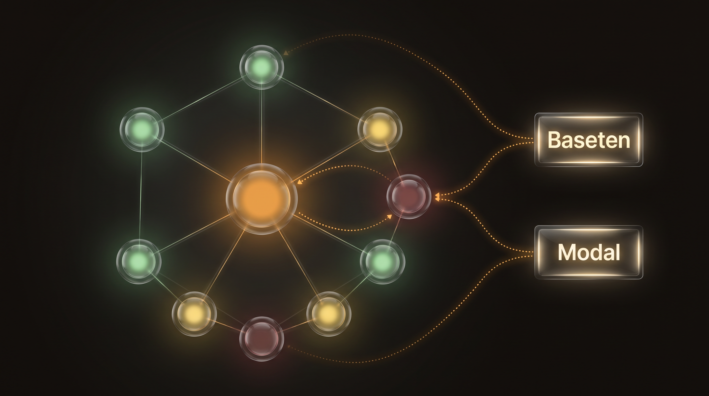
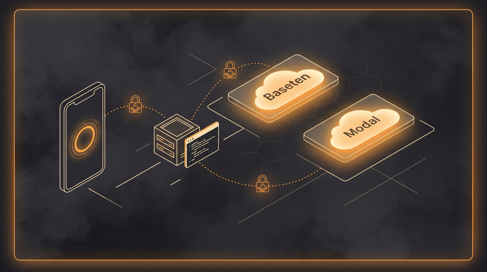

# Hearth

Hearth is a calm center for life, health, and AI agents. It runs on your own hardware. It speaks in short plain sentences. It never sends a secret anywhere.

Built with Muse (Meta) for the Meta Global AI Developer Hackathon.


## Built with

- Meta: Muse Spark and Muse Code, Meta Model API, open-weights Muse Spark Open and Muse Glimmer.
- Baseten, Fireworks AI, and Modal: hackathon inference partners for Meta open-weights models.
- See [docs/PARTNERS.md](docs/PARTNERS.md). The Baseten worked example lives in [docs/BASETEN.md](docs/BASETEN.md).

## What it does

- Home: one ring shows the day. One card names the next step.
- Dev flow: watch coding agents across panes, lanes, and commits.
- Needs You: approvals and questions surface in one list.
- Agent bridge: read and message terminal agents from the phone. Preview plus confirm. Full audit.
- Feature tracker: every feature carries status, proof, and links.
- Self-update: signed over-the-air app updates with rollback.
- Plain text: all UI copy follows ASD-STE100 rules. See [docs/ASD-STE100.md](docs/ASD-STE100.md).
- Meta glasses companion: planned. Glanceable cards, voice-first answers.



## Built for Baseten and Modal

Hearth is built to read public text through open-weights models served on **Baseten** and **Modal**, partners of the Meta Global AI Developer Hackathon. Mock mode runs with no key and is what this submission demonstrates. A live run needs your own keys (see `scripts/demo-heavy.sh`); no live calls are recorded in this repo yet. See [docs/BASETEN.md](docs/BASETEN.md) and [docs/PARTNERS.md](docs/PARTNERS.md).



## 5-minute quickstart

Prereqs: Rust stable, Node 22. No keys needed for the demo.

```bash
git clone https://github.com/sanmayp/hearth.git
cd hearth
scripts/demo.sh
```

The demo prints the route manifest, shows the bridge refusing to start
without its token file, and runs the Baseten reader in mock mode.

Full stack next: set `DATABASE_URL`, `REDIS_URL`, and `HEARTH_TOKEN`,
then `cargo run -p hearth-server`. Point the web app at it with
`HEARTH_API=http://127.0.0.1:8080` and `npm run dev` in `web/`.

## AI usage (metered, honest)

`tools/ai-batch` fans public text out to Baseten or Modal with
concurrency caps, cost caps, retries, and per-call meters. Mock
runs stay labelled mock and never mix with live numbers.

- Dry-run first (no calls, no spend): `scripts/demo-heavy.sh`
- Mock batch: `scripts/demo-heavy.sh --mock-run`
- Live batch: keys in env, then
  `scripts/demo-heavy.sh --live --provider=baseten --max-calls=200`

Live calls in the last run: 0 (4 mock calls). Full table lives in
[docs/USAGE-REPORT.md](docs/USAGE-REPORT.md), generated from real
meter files, never hand-written. The app shows the same numbers
on Settings and Dev flow.

## Repo map

- `crates/hearth-server`: API server. All modules mount under `/v1`.
- `crates/agent-bridge`: phone-to-terminal bridge. Loopback only.
- `modules/`: one domain per crate. Each owns its routes and migrations.
- `web/`: SvelteKit app plus Tauri shell for phone and desktop.
- `tools/baseten-reader`: optional model reader. Mock mode needs no key.
- `docs/`: architecture, bridge, dev flow, Baseten, partners, security.

## Docs

- [ARCHITECTURE](docs/ARCHITECTURE.md) — parts and data flow.
- [BRIDGE](docs/BRIDGE.md) — agent bridge safeguards.
- [DEV-FLOW](docs/DEV-FLOW.md) — how lanes ship.
- [BASETEN](docs/BASETEN.md) — run a model on Baseten.
- [PARTNERS](docs/PARTNERS.md) — Fireworks and Modal notes.
- [SECURITY](docs/SECURITY.md) — keys and safe setup.
- [ASD-STE100](docs/ASD-STE100.md) — the writing standard.

## Security

This repo holds no secrets. Set your own keys at deploy.
Read [docs/SECURITY.md](docs/SECURITY.md) first.

## License

MIT. See [LICENSE](LICENSE).
