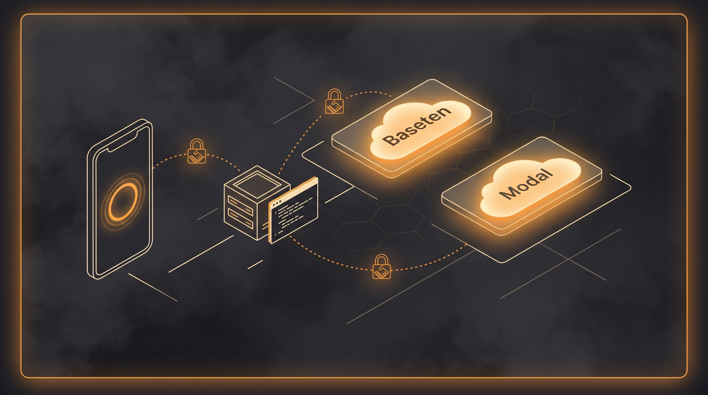
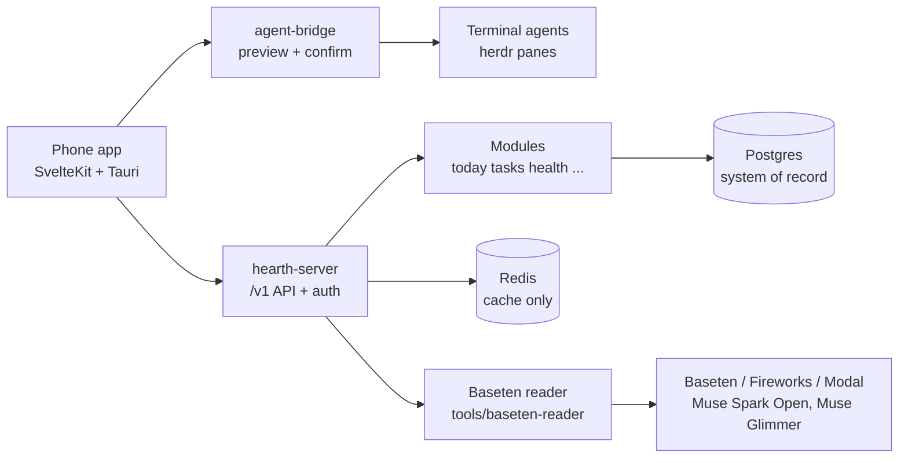

# Architecture

Hearth splits into three parts. The app shows state. The server owns
state. The bridge reaches terminal agents. Each part runs alone.

## Diagram

## Parts

- Web app: SvelteKit UI in `web/`. Tauri wraps it for phone and desktop.
- API server: `crates/hearth-server`. It mounts one domain crate per
  module under `/v1`. Bearer key guards all `/v1` routes.
- Modules: `modules/`. Each module owns its id, migrations, routes,
  jobs, tools, and widgets. Modules never read each other's tables.
- Agent bridge: `crates/agent-bridge`. It binds loopback only. It has
  its own token file. It sends text only after preview plus confirm.
- Reader: `tools/baseten-reader`. It sends public text to a model on
  Baseten and prints a short summary. Mock mode needs no key.
- Data: Postgres holds records. Redis holds cache and queues only.

## Request flow

1. The app calls `/v1/...` with a Bearer key.
2. The server checks the key, then routes to the module.
3. The module reads Postgres, or Redis for cache.
4. The app renders the answer in plain ASD-STE100 words.

## Bridge flow

1. The app lists allowlisted panes through the bridge.
2. The owner types a draft and taps Preview.
3. The app shows the exact text plus a 60-second timer.
4. The owner taps Confirm. The bridge checks code, allowlist,
   rate limit, kind, and status. Then it sends.
5. Each attempt appends one audit line. Text never logs.

See [BRIDGE](BRIDGE.md) for the full safeguard list.
